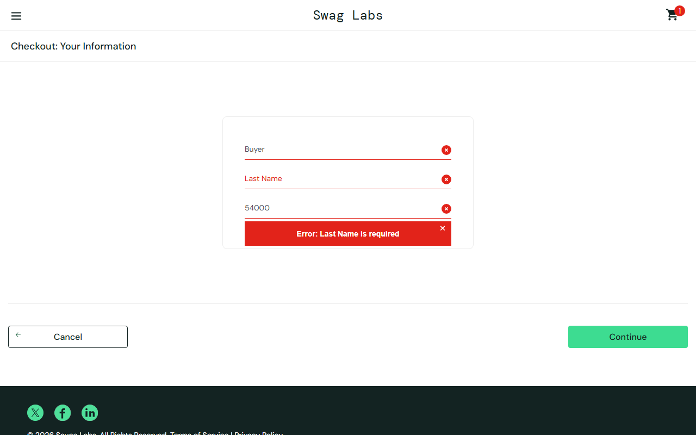
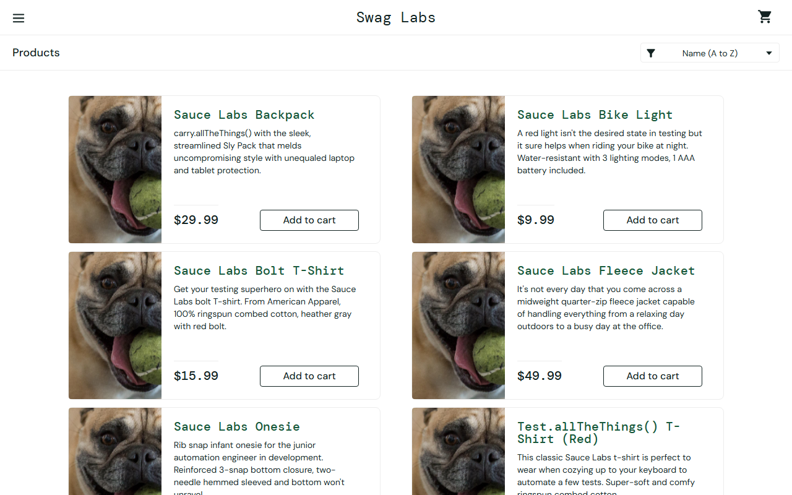

# Bug report: Sauce Demo (exploratory session)

**Tester:** Shahryar Abbas · **Date:** 16 Nov 2026
**Build:** https://www.saucedemo.com (public practice site)
**Devices:** Desktop Chrome, iPhone 15 (WebKit), Android Pixel 7 (Chromium)
**Method:** AI-assisted exploratory session (Claude Code + Playwright) on each special account, then each bug locked in as an automated "known bug" test in [`tests/known-bugs.spec.ts`](tests/known-bugs.spec.ts)

> The site ships special accounts (`problem_user`, `error_user`, `visual_user`) that contain planted bugs.
> The goal here is to show how I find, write up and track bugs, the same way I do on real client work.

## Summary

| ID | Account | Area | Bug | Severity |
|---|---|---|---|---|
| BUG-01 | problem_user | Product list | All 6 products show the same placeholder image | Medium |
| BUG-02 | problem_user | Sorting | Sort by price / name does nothing | Medium |
| BUG-03 | problem_user | Cart | "Add to cart" does nothing for 3 of 6 products | **High** |
| BUG-04 | problem_user | Cart | "Remove" does nothing | High |
| BUG-05 | problem_user | Product page | Clicking a product opens a different product | High |
| BUG-06 | problem_user | Checkout | Typing in Last Name overwrites First Name, order cannot be placed | **Critical** |
| BUG-07 | error_user | Sorting | Sort by price / name does nothing | Medium |
| BUG-08 | error_user | Cart | "Add to cart" does nothing for 3 of 6 products | High |
| BUG-09 | error_user | Checkout | Last Name cannot be typed, but checkout continues without it (validation skipped) | High |
| BUG-10 | error_user | Checkout | "Finish" does nothing, order is never placed | **Critical** |
| BUG-11 | visual_user | Product list | Prices change randomly on every page load | **Critical** |

**Severity guide:** Critical = blocks a purchase or shows wrong money · High = core feature broken, workaround hard · Medium = feature broken, purchase still possible

---

## Details

### BUG-06 · Critical · Typing in Last Name overwrites First Name
**Steps**
1. Log in as `problem_user`
2. Add any product to the cart, open the cart, click **Checkout**
3. Type `Test` in First Name, `Buyer` in Last Name, `54000` in Postal Code
4. Click **Continue**

**Expected:** Order overview page opens.
**Actual:** First Name shows `Buyer`, Last Name is empty, error "Last Name is required". The buyer cannot finish the order.
**Impact:** 100% of checkouts blocked for this user. Lost sales.

### BUG-10 · Critical · "Finish" does nothing
**Steps:** Log in as `error_user` → add a product → checkout → fill info → Continue → click **Finish**
**Expected:** "Thank you for your order!" page.
**Actual:** Nothing happens. The page stays on the overview. No message to the buyer.
**Impact:** Buyer thinks the order may or may not be placed (risk of double orders or support tickets).

### BUG-11 · Critical · Prices change on every page load
**Steps:** Log in as `visual_user` → note the product prices → reload the page.
**Expected:** Same prices.
**Actual:** Every price changes (example seen: Backpack `$86.54` then `$35.56`).
**Impact:** Wrong prices shown to buyers. Legal and trust risk.

### BUG-09 · High · Checkout skips the Last Name check
**Steps:** Log in as `error_user` → checkout → type in all 3 fields → Continue.
**Expected:** Last Name is saved, or the form shows "Last Name is required".
**Actual:** Last Name stays empty, but the form moves to the next step anyway.
**Impact:** Orders saved with missing customer data. Note: for `problem_user` the same check *does* fire (BUG-06), so validation is not consistent between flows.

### BUG-03 / BUG-08 · High · "Add to cart" fails for half the products
**Steps:** Log in → click **Add to cart** on all 6 products.
**Expected:** Cart badge shows 6.
**Actual:** Badge shows 3. Bolt T-Shirt, Fleece Jacket and the Red T-Shirt are not added, with no error.

### BUG-04 · High · "Remove" does nothing (`problem_user`)
**Actual:** After clicking Remove, the item stays in the cart and the badge does not change.

### BUG-05 · High · Wrong product page (`problem_user`)
**Actual:** Clicking "Sauce Labs Backpack" opens the page for "Sauce Labs Fleece Jacket".

### BUG-02 / BUG-07 · Medium · Sorting does nothing
**Actual:** After choosing "Price (low to high)", the list order stays the same: `29.99, 9.99, 15.99, 49.99, 7.99, 15.99`.

### BUG-01 · Medium · Same image on every product (`problem_user`)
**Actual:** All products show the same placeholder file (`sl-404`). Seen on desktop, iPhone and Android.

